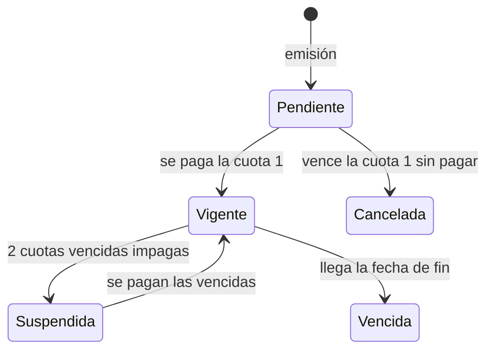
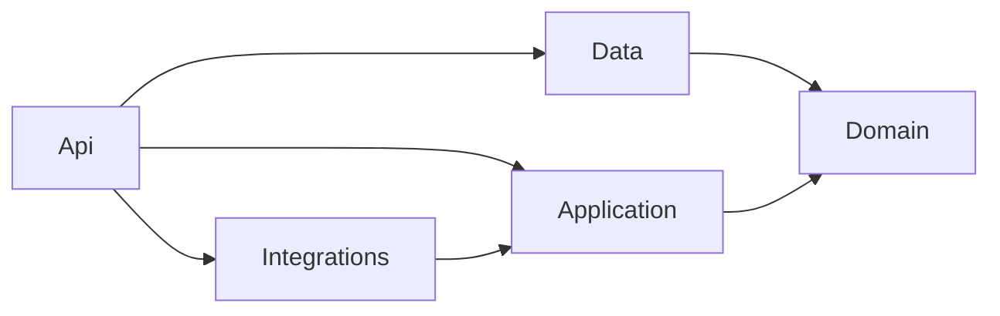

# TFI PAD 2026 — Aseguradora de Vehículos

Sistema de gestión para una aseguradora de autos, motos y camionetas: clientes, vehículos, cotizaciones, pólizas, cuotas mensuales y cobros. Es el Trabajo Final Integrador de Programación de Aplicaciones Distribuidas (UTN, 4.º año), y se integra con los sistemas de otros grupos de la cursada.

> [!NOTE]
> **Estado:** etapa de diseño. La spec del back está definida, con algunos puntos en revisión, y la solución .NET todavía no existe. Este README se completa a medida que se crea el código.

## Qué hace

Una persona quiere asegurar su vehículo. Un empleado la da de alta y el sistema valida su identidad (Renaper) y que sea la titular del vehículo (DNRPA). Después cotiza un plan, emite la póliza y genera una cuota por mes de vigencia (1, 6 o 12). El cliente paga online o en efectivo. Si deja de pagar, la póliza se suspende y deja de cubrir.

- **Dentro del alcance:** clientes, vehículos, planes, cotizaciones, pólizas, cuotas, pagos, facturas, usuarios con roles, integraciones (con mocks), cobro por Pago Fácil con código de barras y servicios para otros grupos.
- **Fuera por ahora:** los fronts en React, siniestros y renovación automática.

| Actor | Qué hace |
| --- | --- |
| Cliente | Sin usuario. Consulta su póliza y paga cuotas en la web con DNI y número de póliza |
| Empleado | Carga y valida clientes, vehículos, cotizaciones y pólizas; cancela pólizas y consulta pagos |
| Administrador | Todo lo del empleado, más gestionar planes y usuarios |

### Ciclo de vida de una póliza



La cancelación manual por un empleado también existe; el detalle de las transiciones sigue en revisión.

## Arquitectura

API REST en C# .NET 8 con SQL Server y Entity Framework Core, en cinco capas dentro de una misma solución.

| Proyecto | Responsabilidad |
| --- | --- |
| `Aseguradora.Domain` | Entidades, enums y reglas propias de cada entidad |
| `Aseguradora.Data` | `DbContext`, configuraciones de EF Core, repositorios, migraciones y seed |
| `Aseguradora.Application` | Servicios de casos de uso, DTOs, excepciones e interfaces de servicios externos |
| `Aseguradora.Integrations` | Implementaciones mock y reales de cada servicio externo |
| `Aseguradora.Api` | Controllers, middleware, autenticación, Swagger y tarea programada de vencimientos |



Los consumidores serán dos fronts en React (etapa posterior): un backoffice para empleados y una web pública para clientes. Autenticación con JWT para empleados y administradores, y API key (`X-Api-Key`) para otros grupos.

## Integraciones

Cada servicio externo se usa detrás de una interfaz con dos implementaciones: un mock con datos de prueba y la real. Se elige por configuración, así nadie queda bloqueado esperando a otro grupo.

| Servicio | Rol | Estado |
| --- | --- | --- |
| Renaper | Valida personas | Otro grupo, mock por ahora |
| ARCA (AFIP) | Autoriza facturas (CAE) | Otro grupo, mock por ahora |
| Pasarelas de pago (2) | Cobro online con webhook | Dos grupos, mock por ahora |
| DNRPA | Valida vehículo y titular | Mock propio |
| Pago Fácil | Cobro en efectivo con código de barras de 42 dígitos | Simulado por nosotros |

Servicios que ofrecemos a otros grupos: seguro vigente por patente, deuda por DNI, cotización externa y webhook de pagos.

## API

Unos 42 endpoints en 11 controllers, documentados en Swagger.

| Área | Ruta base | Acceso |
| --- | --- | --- |
| Autenticación y usuarios | `/api/auth` | Público / Admin |
| Clientes, vehículos, cotizaciones, pólizas, pagos | `/api/clientes`, `/api/vehiculos`, `/api/cotizaciones`, `/api/polizas`, `/api/pagos` | Empleado |
| Planes | `/api/planes` | Público (lectura) / Admin |
| Pago Fácil | `/api/pagofacil` | Empleado |
| Web pública | `/api/publico` | Sin login, con DNI y número de póliza |
| Sistemas externos | `/api/externo`, `/api/webhooks` | API key |

## Trabajar en el proyecto

El flujo es obligatorio para personas y asistentes de IA: una tarjeta de Trello, una rama y un PR hacia `development`. Nunca se commitea directo en `main` ni en `development`.

```
main  ←  development  ←  feature/US-XX-nombre-descriptivo
```

Detalle completo en [`docs/workflow.md`](docs/workflow.md).

> [!IMPORTANT]
> Los asistentes de IA leen [`AGENTS.md`](AGENTS.md) o [`CLAUDE.md`](CLAUDE.md), que les indican seguir ese flujo. Lo que realmente bloquea los pushes directos es la protección de ramas de GitHub.

## Documentación

- [`docs/workflow.md`](docs/workflow.md): flujo de ramas, Trello y PRs.
- `docs/AnalisisBack.md`: spec completa del back (casos de uso, reglas de negocio, modelo de datos, endpoints y contratos de integración). No está versionada: pedírsela al equipo.