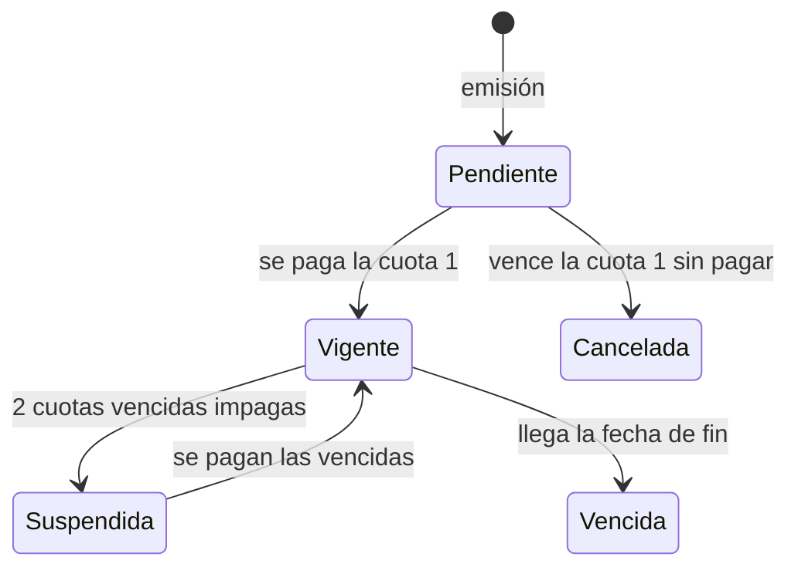
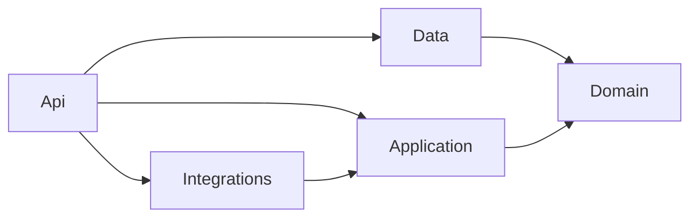

# Nexa Seguros — Aseguradora de Vehículos

Sistema de gestión para una aseguradora de autos, motos y camionetas: clientes, vehículos, cotizaciones, pólizas, cuotas mensuales y cobros. Es el Trabajo Final Integrador de Programación de Aplicaciones Distribuidas (UTN, 4.º año), y se integra con los sistemas de otros grupos de la cursada.

[Qué hace](#qué-hace) · [Arquitectura](#arquitectura) · [Correr en local](#correr-en-local) · [Despliegue](#despliegue) · [Trabajar en el proyecto](#trabajar-en-el-proyecto) · [Documentación](#documentación)

> [!NOTE]
> **Estado:** el back (API, datos, integraciones mock y tests) y los dos fronts (backoffice y web pública) están implementados y publicados. Lo que queda son verificaciones visuales contra el Figma. Las tareas se siguen en [`docs/tareas-divididas.md`](docs/tareas-divididas.md) y [`docs/frontend/tareas/INDEX.md`](docs/frontend/tareas/INDEX.md).

## Qué hace

Una persona quiere asegurar su vehículo. Un empleado la da de alta y el sistema valida su identidad (Renaper) y que sea la titular del vehículo (DNRPA). Después cotiza un plan, emite la póliza y genera una cuota por mes de vigencia (1, 6 o 12). El cliente paga online o en efectivo. Si deja de pagar, la póliza se suspende y deja de cubrir.

| Actor | Qué hace |
| --- | --- |
| Cliente | Sin usuario. Consulta su póliza y paga cuotas en la web pública con DNI y número de póliza |
| Empleado | Carga y valida clientes, vehículos, cotizaciones y pólizas; cobra en caja; cancela pólizas y consulta pagos |
| Administrador | Todo lo del empleado, más gestionar planes y usuarios |

Fuera de alcance: siniestros y renovación automática.

### Ciclo de vida de una póliza



La cancelación manual por un empleado también existe.

## Arquitectura

```text
backend/    API REST en C# .NET 8, SQL Server y Entity Framework Core
frontend/   Monorepo npm con las dos apps React y los paquetes compartidos
docs/       Flujo de trabajo, tareas, despliegue y documentación del front
```

### Back

Cinco capas dentro de una misma solución (`backend/Aseguradora.sln`).

| Proyecto | Responsabilidad |
| --- | --- |
| `Aseguradora.Domain` | Entidades, enums y reglas propias de cada entidad |
| `Aseguradora.Data` | `DbContext`, configuraciones de EF Core, repositorios, migraciones y seed |
| `Aseguradora.Application` | Servicios de casos de uso, DTOs, excepciones e interfaces de servicios externos |
| `Aseguradora.Integrations` | Implementaciones mock y reales de cada servicio externo |
| `Aseguradora.Api` | Controllers, middleware, autenticación, Swagger y tarea programada de vencimientos |



Autenticación con JWT para empleados y administradores, y API key (`X-Api-Key`) para otros grupos.

### Front

React 18 + TypeScript + Vite, con arquitectura screaming (carpetas por dominio). Se organiza en `frontend/` (npm workspaces):

| Workspace | Qué es |
| --- | --- |
| `apps/backoffice` | App de empleados y administración (puerto `5173`) |
| `apps/web-publica` | App de clientes, sin login (puerto `5174`) |
| `packages/ui` (`@nexa/ui`) | Componentes y tokens del design system |
| `packages/api` (`@nexa/api`) | Cliente HTTP, DTOs y mocks MSW |
| `packages/config` (`@nexa/config`) | Configuración de lint, TypeScript y Vitest |

Detalle de comandos, puertos, variables y mocks en [`frontend/README.md`](frontend/README.md).

## Integraciones

Cada servicio externo se usa detrás de una interfaz con dos implementaciones: un mock con datos de prueba y la real. Se elige por configuración, así nadie queda bloqueado esperando a otro grupo.

| Servicio | Rol | Estado |
| --- | --- | --- |
| Renaper | Valida personas | Otro grupo, mock por ahora |
| ARCA (AFIP) | Autoriza facturas (CAE) | Otro grupo, mock por ahora |
| Pasarelas de pago (2) | Cobro online con webhook | Dos grupos, mock por ahora |
| DNRPA | Valida vehículo y titular | Mock propio |
| Pago Fácil | Cobro en efectivo con código de barras de 42 dígitos | Simulado por nosotros |

Servicios que ofrecemos a otros grupos: seguro vigente por patente, deuda por DNI, cotización externa y webhook de pagos.

## API

| Área | Ruta base | Acceso |
| --- | --- | --- |
| Autenticación y usuarios | `/api/auth` | Público / Admin |
| Planes | `/api/planes` | Público (lectura) / Admin |
| Clientes | `/api/clientes` | Empleado |
| Vehículos | `/api/vehiculos` | Empleado |
| Cotizaciones | `/api/cotizaciones` | Empleado |
| Pólizas | `/api/polizas` | Empleado |
| Pagos | `/api/pagos` | Empleado |
| Pago Fácil | `/api/pagofacil` | Empleado |
| Web pública | `/api/publico` | Sin login, con DNI y número de póliza |
| Servicios para otros grupos | `/api/externo` | API key |
| Webhooks de pasarelas | `/api/webhooks` | API key |

Swagger lo controla `SWAGGER_HABILITADO` en el `.env`: viene en `true` en `.env.example` (local) y apagado en producción.

## Correr en local

Requisitos: Docker, el SDK de .NET 8 y Node 20 o superior.

### Back

```bash
cp .env.example .env   # completar los valores; nunca se sube a Git
docker compose up -d --build --wait   # espera a que la API esté healthy (puede tardar un minuto)
curl http://localhost:8080/health
```

> [!IMPORTANT]
> La API no arranca si faltan `FACTURACION_CUIT` y `FACTURACION_PUNTO_VENTA` en el `.env`.

### Front

```bash
cd frontend
npm ci
npm run dev --workspace=@nexa/backoffice    # http://localhost:5173
npm run dev --workspace=@nexa/web-publica   # http://localhost:5174
```

Abrir siempre `localhost`, no `127.0.0.1`: el CORS del back compara el origen exacto. Con `VITE_USE_MOCKS=true` el front usa MSW en lugar del back; ver [`frontend/README.md`](frontend/README.md).

### Tests

```bash
cd backend && dotnet test                                         # back
cd frontend && npm run lint && npm run typecheck && npm test      # front
cd frontend && npm run e2e                                        # smoke e2e (Playwright)
```

Las pruebas de integración con SQL Server solo corren con `ASEGURADORA_TESTS_DOCKER=1` (y Docker disponible); sin esa variable se omiten. Detalle en [`backend/Aseguradora.Tests/README.md`](backend/Aseguradora.Tests/README.md).

## Despliegue

- **API:** VM en Azure con Docker Compose, expuesta por Cloudflare Tunnel en `https://api.nexaseguros.me`.
- **Backoffice:** Cloudflare Pages (integración Git), en `app.nexaseguros.me`.
- **Web pública:** Cloudflare Pages (Direct Upload desde GitHub Actions), en `nexaseguros.me`.

`main` es producción: cada merge publica los fronts. Pasos y releases en [`docs/despliegue.md`](docs/despliegue.md) y [`docs/workflow.md`](docs/workflow.md).

## Trabajar en el proyecto

El flujo es obligatorio para personas y asistentes de IA: una tarjeta de Trello, una rama y un PR hacia `development`. Nunca se commitea directo en `main` ni en `development`.

```text
main  ←  development  ←  feature/US-XX-nombre-descriptivo
```

El CI del PR corre `backend`, `frontend`, `concurrencia-sqlserver` y `branch-name`. Los PR que tocan `frontend/` además exigen React Doctor en 100/100. Detalle completo en [`docs/workflow.md`](docs/workflow.md).

> [!IMPORTANT]
> Los asistentes de IA leen [`AGENTS.md`](AGENTS.md) o [`CLAUDE.md`](CLAUDE.md), que les indican seguir ese flujo. Lo que realmente bloquea los pushes directos es la protección de ramas de GitHub.

## Documentación

- [`docs/workflow.md`](docs/workflow.md): flujo de ramas, Trello, PRs y releases a `main`.
- [`docs/tareas-divididas.md`](docs/tareas-divididas.md): tareas del back, una sección por tarjeta.
- [`docs/frontend/`](docs/frontend/tareas/INDEX.md): decisiones, design system, pantallas, contratos de API y tareas del front.
- [`docs/despliegue.md`](docs/despliegue.md): API en Azure con Cloudflare Tunnel y fronts en Cloudflare Pages.
- [`docs/integraciones.md`](docs/integraciones.md): servicios externos y sus mocks.
- [`docs/api-externa.md`](docs/api-externa.md): guía para que otros grupos usen nuestra API (seguro vigente, deuda, cotización) y cómo obtienen su clave (autoservicio en el backoffice, con aprobación de un administrador).
- [`docs/pagos-mocks.md`](docs/pagos-mocks.md) y [`docs/aprobacion-pagos.md`](docs/aprobacion-pagos.md): pasarelas mock y aprobación de pagos.
